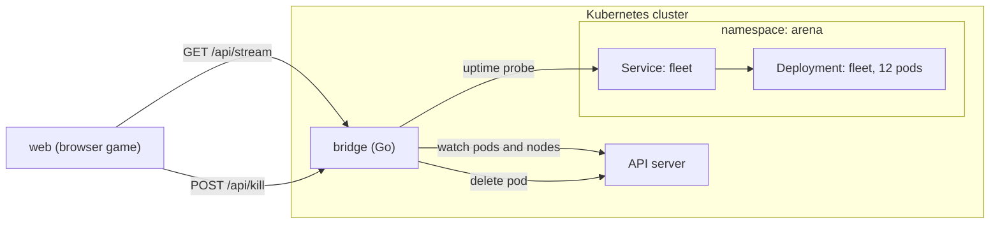

# Architecture

Three parts: a game in the browser, a small Go service called the bridge, and a Kubernetes cluster.
This file describes the target for v0. Later versions add to it without changing the shape.



## Parts

| Path | What it is | Built with | From |
|---|---|---|---|
| `web/` | The game | TypeScript, three.js, Vite | v0 |
| `bridge/` | The only door between the game and the cluster | Go, client-go | v0 |
| `deploy/kind/` | Local cluster config | kind | v0 |
| `deploy/arena/` | The targets: the `fleet` Deployment and Service | Plain YAML | v0 |
| `deploy/bridge/` | The bridge and its permissions | Plain YAML | v0 |
| `deploy/chart/` | Everything above as one chart | Helm | v1 |
| `content/codex/` | Learning entries shown by the scanner | Markdown with front matter | v1 |

## Namespaces

| Namespace | Holds | Who can delete pods there |
|---|---|---|
| `arena` | The targets | The bridge |
| `powd` | The bridge, and the web server from v1 | Nobody |

## One kill, step by step

1. A bullet hits a fighter. The game shows the hit in the same frame.
2. The game sends `POST /api/kill` with the pod UID.
3. The bridge applies the rate limit, then looks the UID up in its cache.
4. The bridge asks the API server to delete the pod.
5. The API server marks the pod as terminating. The bridge streams that change.
6. The ReplicaSet controller counts one pod too few and creates a new one.
7. The scheduler picks a node. The kubelet on that node starts the container.
8. The readiness probe passes. The bridge streams the pod as ready.
9. The game warps in a new fighter.

## Bridge API

The bridge and the browser simulator (v1) both speak this contract.

### `GET /api/stream`

Server-Sent Events. The connection stays open.

| Event | Sent | Data |
|---|---|---|
| `snapshot` | First, and again after every reconnect | `{"protocol": 1, "mode": "live", "pods": [Pod], "nodes": [Node]}` |
| `pod` | When a pod changes | `{"type": "added", "pod": Pod}` |
| `node` | When a node changes | `{"type": "updated", "node": Node}` |
| `uptime` | Every second, from v0-11 | `{"total": 5400, "failed": 0, "window": {"seconds": 60, "total": 600, "failed": 0}}` |

`type` is `added`, `updated`, or `deleted`. `mode` is `live` or `sim`.

```json
{
  "uid": "0b6c1f0e-5d0a-4f43-9d9e-1c2f3a4b5c6d",
  "name": "fleet-7d9c5b6f4-x2x9k",
  "node": "powd-worker2",
  "phase": "Running",
  "ready": true,
  "terminating": false,
  "owner": "fleet-7d9c5b6f4",
  "createdAt": "2026-11-19T15:04:05Z"
}
```

A Pod. `node` is empty until the pod is scheduled. `owner` is the ReplicaSet name.

```json
{ "name": "powd-worker2", "ready": true, "schedulable": true, "controlPlane": false }
```

A Node.

### `POST /api/kill`

Body: `{"uid": "<pod uid>"}`.

| Status | Meaning |
|---|---|
| 202 | The delete was sent |
| 400 | The body is not valid |
| 404 | No pod with this UID in `arena` |
| 409 | The pod is already terminating |
| 429 | Rate limit hit. See the `Retry-After` header |

### Health

`GET /healthz` says the process is alive. `GET /readyz` says the informer caches are synced.

### Changing the contract

Change this file, the bridge, and the simulator in the same pull request.
Raise `protocol` when an old client would break.

## Measures

| HUD value | Definition |
|---|---|
| `UPTIME` | Good probe requests divided by all probe requests, over the last 60 seconds |
| `FAILED` | Failed probe requests since the bridge started |
| `RECOVERY` | Time from a kill request until the next new pod is ready. New pods are matched to kills in order, oldest kill first. |

## Safety model

1. The browser never reaches the Kubernetes API. Only the bridge does.
2. The bridge identity can read and delete pods in `arena`, and read nodes. It has no other permission.
3. A client sends a UID. The bridge only accepts UIDs it already saw in `arena`.
4. Every kill request passes a rate limit before anything else happens.
5. The Makefile and scripts always name their cluster. They never rely on the current kubectl context.
6. The repo holds no secrets and no `.env` files.

## Modes

| Mode | Cluster | Where it runs | From |
|---|---|---|---|
| `live` | Real, through the bridge | Your machine, or a demo cluster | v0 |
| `sim` | Simulated in the browser | Any static host, for free | v1 |

The HUD always shows which mode is active.

## Decisions

The reasons behind these choices are in [docs/DECISIONS.md](docs/DECISIONS.md).
